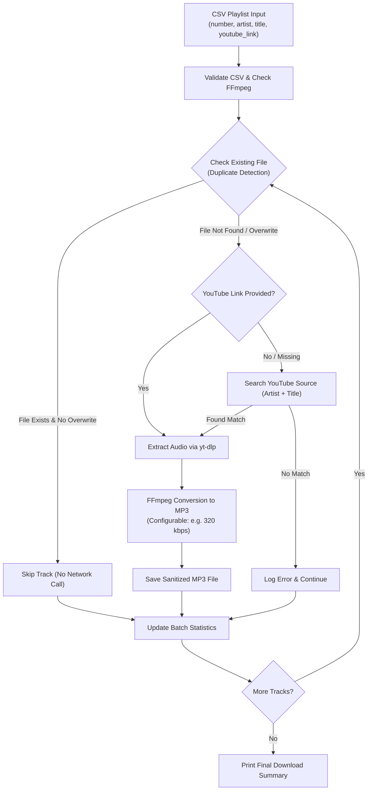

# WaveCrate

[](https://www.python.org/)
[](https://github.com/yt-dlp/yt-dlp)
[](https://ffmpeg.org/)
[](https://opensource.org/licenses/MIT)

**WaveCrate** is a lightweight, automated Python tool designed to batch-process playlist CSV files, match authorized YouTube audio sources, and convert tracks into high-bitrate MP3 files with clean metadata and safe filenames.

Designed with DJ preparation, audio archiving, and offline listening in mind, WaveCrate handles batch downloads sequentially, provides real-time progress reporting, and guarantees duplicate overwrite protection.

---

## Workflow Diagram



---

## Features

- **Automated Sequential Processing**: Ingests playlist CSV files and processes all songs automatically without requiring manual confirmation between tracks.
- **Robust CSV Ingestion**: Built using Python's `csv.DictReader` with UTF-8 BOM (`utf-8-sig`) support, tolerating case-insensitive headers and variations (`number`, `artist`, `title`, `youtube_link`).
- **Flexible Source Resolution**: Downloads directly from specified YouTube URLs or automatically searches YouTube for `{artist} - {title}` if links are missing or empty.
- **Studio Bitrate Encoding**: Powered by FFmpeg to extract and encode audio into MP3 with configurable bitrates (128, 192, 256, or 320 kbps; default: **320 kbps**).
- **Safe & Standardized Filenames**: Automatic cross-platform sanitization removing illegal filesystem characters (`<>:"/\|?*`), non-printable Unicode, and trailing dots/spaces while avoiding Windows reserved device names (`CON`, `PRN`, `AUX`, `NUL`).
- **Duplicate & Overwrite Protection**: Detects if the target MP3 already exists in your destination folder and skips redundant downloads unless explicitly told to overwrite.
- **Resilient Fault Tolerance**: If a single song fails (e.g., video removed, geo-blocked, private), WaveCrate logs the error, records it in the failure registry, and seamlessly continues processing the rest of the queue.
- **Graceful Interruption**: Pressing `Ctrl+C` halts processing safely and immediately generates a summary of all songs completed before interruption.
- **Zero Module Clutter**: Minimalist single-file architecture (`main.py`) adhering strictly to PEP 8 standards.

---

## Technologies Used

- **Python 3.8+**: Core programming language.
- **[yt-dlp](https://github.com/yt-dlp/yt-dlp)**: Industry-standard, actively maintained video/audio extraction engine.
- **[FFmpeg](https://ffmpeg.org/)**: Multimedia framework for high-fidelity audio transcoding to MP3.

---

## Requirements and Prerequisites

1. **Python 3.8 or higher**: [Download Python](https://www.python.org/downloads/) (Make sure to check *"Add Python to PATH"* during installation).
2. **FFmpeg**: Required for audio extraction and MP3 encoding.

---

## Installation Guide (Windows)

### 1. Clone or Download the Repository

```bash
git clone https://github.com/your-username/WaveCrate.git
cd WaveCrate
```

### 2. Set Up a Virtual Environment (Recommended)

In PowerShell or Command Prompt:

```bash
python -m venv .venv
.venv\Scripts\activate
```

### 3. Install Python Dependencies

```bash
pip install -r requirements.txt
```

### 4. Install and Verify FFmpeg

WaveCrate requires FFmpeg on your system PATH to transcode audio streams to MP3.

#### Option A: Using Windows Package Manager (`winget`) — Recommended
Open PowerShell as an Administrator and run:
```powershell
winget install Gyan.FFmpeg
```
Restart your terminal after installation completes.

#### Option B: Manual Installation
1. Download a pre-built release build from [Gyan.dev FFmpeg Builds](https://www.gyan.dev/ffmpeg/builds/) (e.g., `ffmpeg-release-essentials.zip`).
2. Extract the archive (e.g., to `C:\ffmpeg`).
3. Add `C:\ffmpeg\bin` to your System `PATH` environment variable.

#### Verification:
Verify FFmpeg is recognized in your terminal:
```bash
ffmpeg -version
```
If version information appears, FFmpeg is correctly installed.

> **Note**: If FFmpeg is stored in a custom folder, you can also pass its location directly to WaveCrate using the `--ffmpeg-location` flag without modifying your system PATH.

---

## CSV File Format

WaveCrate accepts standard CSV files exported from playlist tools or spreadsheets. 

### Supported Columns

| Column Name | Required | Description |
|---|---|---|
| `number` | Optional | Track sequence number (auto-assigned if missing). |
| `artist` | Recommended | Artist or creator name. |
| `title` | **Required** | Song or track title. |
| `youtube_link` | Optional | Direct YouTube video URL. If left empty, WaveCrate can auto-search YouTube. |

### Example `playlist.csv`

```csv
number,artist,title,youtube_link
1,"The Chemical Brothers",Galvanize,https://www.youtube.com/watch?v=H2hzVV2Nwfs
2,"Fatboy Slim",Right Here Right Now,https://www.youtube.com/watch?v=ub747pprmJ8
3,"Daft Punk",One More Time,
```

> **Tip**: Notice that track #3 has an empty `youtube_link`. By default, WaveCrate will search YouTube for `"Daft Punk One More Time"` and download the top audio match.

---

## How to Run

### Basic Usage

Place your `playlist.csv` in the project root and run:

```bash
python main.py
```

### Specify a Custom CSV Path and Output Folder

```bash
python main.py my_playlist.csv --output "C:\Music\Collection"
```

### Change Target Bitrate

```bash
python main.py playlist.csv --bitrate 256
```

### Overwrite Existing Files

```bash
python main.py playlist.csv --overwrite
```

### Include Sequential Track Numbers in Filenames

```bash
python main.py playlist.csv --track-numbers
```
*Output: `01 - The Chemical Brothers - Galvanize.mp3`*

### Disable Automatic YouTube Search

```bash
python main.py playlist.csv --no-search
```
*(Only tracks with explicit, valid YouTube URLs will be processed; missing links will be flagged as failed).*

---

## Configuration Options

Run `python main.py --help` to view all CLI options:

```text
usage: WaveCrate [-h] [-o OUTPUT] [-b {128,192,256,320}] [--overwrite]
                 [--track-numbers] [--no-search] [--ffmpeg-location FFMPEG_LOCATION]
                 [csv_file]

Automated playlist processor, YouTube matcher, and MP3 converter.

positional arguments:
  csv_file              Path to the playlist CSV file (default: playlist.csv)

options:
  -h, --help            show this help message and exit
  -o OUTPUT, --output OUTPUT
                        Destination directory for converted MP3 audio files (default: downloads)
  -b {128,192,256,320}, --bitrate {128,192,256,320}
                        Target MP3 audio bitrate in kbps (default: 320)
  --overwrite           Overwrite existing MP3 files instead of skipping them (default: False)
  --track-numbers       Prefix output filenames with sequential track numbers (default: False)
  --no-search           Disable automatic YouTube search when youtube_link is empty (default: False)
  --ffmpeg-location FFMPEG_LOCATION
                        Custom path to the FFmpeg executable or binary directory (default: None)
```

---

## Example Output Structure

```text
WaveCrate/
├── main.py
├── README.md
├── requirements.txt
├── .gitignore
├── playlist.csv          <- Your input playlist (git-ignored)
└── downloads/            <- Automatically created output folder
    ├── Daft Punk - One More Time.mp3
    ├── Fatboy Slim - Right Here Right Now.mp3
    └── The Chemical Brothers - Galvanize.mp3
```

---

## Example Terminal Output

```text
Reading playlist CSV...
Loaded 3 track(s) from 'playlist.csv'.
Target Bitrate   : 320 kbps
Output Directory : C:\Users\User\WaveCrate\downloads

[1/3] Processing: The Chemical Brothers - Galvanize
       Source : https://www.youtube.com/watch?v=H2hzVV2Nwfs
       Status : [SUCCESS] Saved: The Chemical Brothers - Galvanize.mp3 (320 kbps)

[2/3] Processing: Fatboy Slim - Right Here Right Now
       Source : https://www.youtube.com/watch?v=ub747pprmJ8
       Status : [SKIPPED] File already exists: Fatboy Slim - Right Here Right Now.mp3

[3/3] Processing: Daft Punk - One More Time
       Source : [Auto-Search Query]
       Status : [SUCCESS] Saved: Daft Punk - One More Time.mp3 (320 kbps)

======================================================================
                      WAVECRATE BATCH SUMMARY
======================================================================
  Total Tracks in CSV  : 3
  Successfully Converted: 2
  Skipped (Existing)   : 1
  Failed               : 0
  Output Directory     : C:\Users\User\WaveCrate\downloads
======================================================================
```

---

## Limitations of 320 kbps Conversion

When converting audio from online video streams into 320 kbps MP3:
- **Audio Source Ceiling**: YouTube streams audio using modern codecs such as Opus (typically ~160 kbps) or AAC (~128 kbps).
- **Transcoding vs. Quality**: Re-encoding a 160 kbps Opus stream into a 320 kbps MP3 creates a standard Constant Bitrate (CBR) MP3 container. While this ensures broad compatibility with car audio systems, legacy media players, and DJ software (Pioneer CDJs, Rekordbox, Serato), **it cannot restore acoustic data lost in the original stream compression**.
- **Container Compatibility**: 320 kbps is the maximum standard bitrate supported by the MP3 codec and avoids introducing additional generation loss during playback.

---

## Troubleshooting

| Issue | Cause | Solution |
|---|---|---|
| `[ERROR] FFmpeg was not found on your system PATH` | FFmpeg is not installed or not registered in PATH. | Install FFmpeg via `winget install Gyan.FFmpeg`, or pass `--ffmpeg-location "C:\path\to\ffmpeg\bin"`. |
| `[ERROR] The 'yt-dlp' library is not installed` | Missing Python package. | Run `pip install -r requirements.txt` in your active virtual environment. |
| `[FAILED] yt-dlp error: Video unavailable` | The video is geo-restricted, removed, or private. | Verify the URL in a browser or provide an alternative link in your CSV. |
| Characters replaced in filenames | Illegal filesystem characters (`/`, `\`, `:`, `*`, `?`, `"`, `<`, `>`, `\|`). | This is intentional to ensure safe storage across Windows, macOS, and Linux. |
| `[SKIPPED] File already exists` | Target file is already present in the output folder. | Use the `--overwrite` flag if you want to re-download and re-encode the file. |

---

## Responsible-Use Disclaimer

WaveCrate is intended for downloading and archiving **authorized audio**, royalty-free media, Creative Commons content, or personal recordings where you possess the explicit legal rights or permission from the copyright owner.

Users are strictly responsible for complying with YouTube's Terms of Service and applicable copyright regulations in their jurisdiction. The developers and contributors of WaveCrate assume no liability for misuse of this tool.

---

## Future Improvements

- [ ] Automated ID3v2 tag writing (embedding Artist, Title, Album, and Cover Art).
- [ ] Exporting summary reports to JSON / CSV.
- [ ] Multi-threaded concurrent downloads for large playlist archives.
- [ ] Direct Spotify / Apple Music playlist URL scraper integration without requiring intermediate CSV files.

---

## License

This project is licensed under the [MIT License](https://opensource.org/licenses/MIT).
